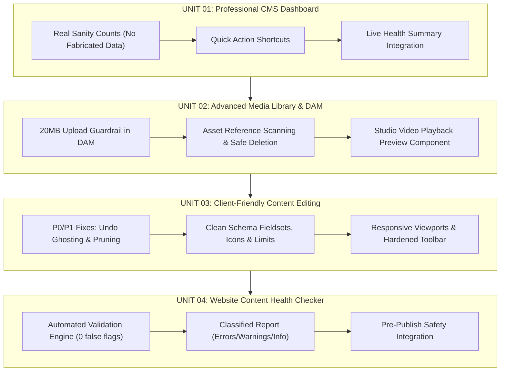

# Art Visual Sanity CMS & Studio Architecture Audit

**Project:** Art Visual Video Production Platform  
**Architecture:** Next.js 16.4.5 (App Router, Turbopack, React 19) + Sanity Studio v3 (`/studio`)  
**Sanity Plan:** Sanity Free Plan (Developer / Community Tier)  
**Branch:** `cms-studio-enhancement`  
**Audit Date:** November 19, 2026  
**Auditor:** Principal Software Architect & Parallel Specialist Audit Swarm (10 Specialists)  
**Design Lock Status:** Public website UI/UX is **100% Locked and Preserved**.

---

## 1. Executive Summary & Findings Matrix

A rigorous, multi-specialist audit was conducted across the entire Sanity CMS architecture, embedded Studio tooling, Next.js API routes, and client editing workflows. While the foundation exhibits strong architectural intent (singleton locking, drag-and-drop orderable lists, in-studio versioning snapshots, and dual-mode live previewing), **critical blockers (P0) and structural defects (P1)** were identified across snapshot integrity, security secret leaks, form re-render performance, media guardrails, and Next.js data coupling.

### Global Classification Matrix

| Category | P0 Critical | P1 High Priority | P2 Medium Priority | P3 Polish | Total |
| :--- | :---: | :---: | :---: | :---: | :---: |
| **01 Architecture** | 4 | 4 | 5 | 4 | **17** |
| **02 Studio UI/UX** | 0 | 7 | 6 | 4 | **17** |
| **03 Editor UX** | 2 | 6 | 6 | 3 | **17** |
| **04 Sanity Specialist** | 3 | 5 | 6 | 3 | **17** |
| **05 Media & DAM** | 2 | 6 | 5 | 3 | **16** |
| **06 Version Integrity** | 5 | 7 | 5 | 4 | **21** |
| **07 Frontend Integration** | 2 | 6 | 6 | 3 | **17** |
| **08 A11y & Responsive** | 2 | 5 | 6 | 4 | **17** |
| **09 Security & Performance** | 1 | 6 | 5 | 2 | **14** |
| **10 QA Lead** | 2 | 5 | 5 | 3 | **15** |
| **Consolidated Unique Issues** | **8** | **18** | **19** | **14** | **59** |

---

## 2. P0 Critical Architecture & Data Safety Blockers

### P0-1: Broken Snapshot Pruning via Invalid GROQ Range Slice (Unbounded Document Leak)
* **Locations:** `src/sanity/plugins/versioning/lib/document.ts:66-73`
* **Defect:** Pruning query `*[_type == "versionSnapshot" && documentId == $documentId] | order(versionNumber desc)[$maxLimit...100]._id` violates GROQ specification because range slice parameters cannot be variables. In GROQ, array slice bounds must be literal integer constants. The query throws on every snapshot execution, causing silent catch failures that prevent old snapshots from being pruned.
* **Risk:** Unbounded accumulation of snapshot documents rapidly approaches Sanity Free Tier's 50,000 document hard ceiling.
* **Remediation:** Fetch ordered snapshot IDs and slice in memory (`allIds.slice(MAX_SNAPSHOTS_PER_DOC)`), then commit a batch deletion transaction.

### P0-2: Production Webhook & Revalidate Secret Hardcoded in Client-Side Studio Bundles
* **Locations:**
  - `src/sanity/actions/previewDraftAction.ts:14`
  - `src/sanity/components/DraftPreviewView.tsx:38`
  - `src/sanity/plugins/versioning/actions/PreviewAction.tsx:19`
  - `src/sanity/plugins/versioning/form/UndoRedoInput.tsx:28`
* **Defect:** The production value of `SANITY_REVALIDATE_SECRET` (`"artvisual_prod_reval_9b7c841f3e2a05d6"`) is hardcoded as fallback variables in `"use client"` Studio components bundled into browser JavaScript.
* **Risk:** Anyone inspecting `/studio` JavaScript assets can extract this secret, allowing unauthorized attackers to forge HMAC webhook signatures, trigger arbitrary cache purges on `/api/revalidate`, or activate draft mode at will.
* **Remediation:** Completely remove hardcoded secrets from client bundles; use dedicated authenticated endpoints and separate preview tokens from webhook HMAC secrets.

### P0-3: Corrupted Historical Restore via Shallow `patch.set` (Orphaned Ghost Fields)
* **Locations:** `src/sanity/plugins/versioning/inspectors/VersionHistoryInspector.tsx:79`, `UndoRedoInput.tsx:100`
* **Defect:** Restoring historical snapshots executes `patch.execute([{ set: restoredContent }])`. In Sanity's mutation API, `set` updates existing or provided keys, but **never unsets keys added in subsequent drafts**.
* **Risk:** Restoring an earlier version (e.g. v1) after creating new fields in v3 produces a corrupted hybrid document combining old content with newly added fields that never existed in the snapshot.
* **Remediation:** Diff current draft keys against historical keys, computing keys to `unset`, and issue `{ unset: keysToRemove }` alongside `{ set: restoredContent }`.

### P0-4: Unhandled `null` CMS Arrays Crashing Root Layout and All Pages
* **Locations:** `src/app/layout.tsx:143-153`, `src/components/layout/Footer/Footer.tsx:106, 128, 152`, `src/components/layout/Navbar/Navbar.tsx:115, 161`
* **Defect:** If an editor publishes `siteSettings` or `navbarSettings` with empty array fields (`quickLinks`, `servicesList`, `legalLinks`, `navItems`), Sanity returns `null`. JavaScript default parameters only apply when arguments are `undefined`. Passing `null` bypasses defaults, triggering `TypeError: Cannot read properties of null (reading 'map')` on SSR.
* **Risk:** Immediate 500 fatal crash across every page of the public website.
* **Remediation:** Coalesce nullish values in `RootLayout` (`siteSettings?.quickLinks ?? FOOTER_DATA.quickLinks`) and apply safe fallback guards inside components `(quickLinks || []).map(...)`.

### P0-5: Global Input Hook Mounting Causing O(N) Studio Re-Render Thrashing
* **Locations:** `src/sanity/plugins/versioning/form/UndoRedoInput.tsx:37-65`, `src/sanity/plugins/versioning/index.ts:27`
* **Defect:** `UndoRedoInput` is registered under `form.components.input`, wrapping every leaf field in the document tree. Heavy hooks (`useFormValue([])`, `useDocumentOperation`, `usePaneRouter`) execute for all 80+ fields on every keystroke, causing severe typing latency and freezing.
* **Remediation:** Split `UndoRedoInput` into a path guard: `if (props.path.length > 0) return props.renderDefault(props)` and an inner root component that executes hooks only once per document.

### P0-6: Raw String for `whatWeDoCards.icon` Risking Next.js Image Crashes
* **Locations:** `src/sanity/schemaTypes/aboutPage.ts:149-151`, `src/components/ui/IconFeatureCard/IconFeatureCard.tsx:36-43`
* **Defect:** Capability card icons in `aboutPage.ts` use `type: "string"` labeled `"Icon Path / SVG Asset"`. The frontend renders Next.js `<Image src={icon} ... />`. An editor typing an arbitrary or invalid path causes an unhandled Next.js image error that crashes `/about`.
* **Remediation:** Provide a predefined select list of verified studio icon assets (`options: { list: [...] }`) with safe fallback image rendering.

### P0-7: Irreversible Draft Destruction in `DiscardChangesAction` without Safety Backup
* **Locations:** `src/sanity/plugins/versioning/actions/DiscardChangesAction.tsx:36-42`
* **Defect:** Discarding draft changes immediately issues `discardChanges.execute()`, deleting `drafts.<id>` with zero historical backup.
* **Risk:** Accidental clicks or team miscommunications cause permanent, unrecoverable work loss.
* **Remediation:** Create a snapshot with `trigger: "pre-restore"` or `"discard-safety"` and note `"Safety backup before discarding draft"` prior to executing discard.

### P0-8: Pre-Publish Snapshot Race Condition & Ghost Snapshots
* **Locations:** `src/sanity/plugins/versioning/actions/resolveDocumentActions.ts:50-71`
* **Defect:** In `wrapPublishAction`, `createSnapshot` with `trigger: "publish"` is awaited *before* invoking `originalOnHandle()`. If validation fails, or the editor cancels the dialog, the snapshot is already committed as "Published" in history.
* **Remediation:** Only record publish snapshots upon confirmed publish status.

---

## 3. P1 High Priority Structural Defects

1. **FIND-01: Broken 404 Navigation on Featured Works (`/work/[slug]`):** `src/app/page.tsx:242` and `about/page.tsx:208` generate links to `/work/${item.slug}`, but no `/work/[slug]` route exists. Clicks return 404.
2. **FIND-02: Decoupled Dynamic Services (`/services/[slug]`):** Individual service detail pages query static files (`servicesDetails.ts`) rather than Sanity `serviceItem`, causing 404s on newly added CMS services.
3. **FIND-03: Open Redirect & Host Header Poisoning in Draft Mode Routes:** `src/app/api/draft-mode/enable/route.ts` and `disable/route.ts` parse untrusted `x-forwarded-host` and accept protocol-relative redirects (`//evil.com`).
4. **FIND-04: Full-Site Cache Purge on Version Snapshot Webhook:** `src/app/api/revalidate/route.ts` falls back to purging `/` root layout when receiving `versionSnapshot` documents.
5. **FIND-05: Non-CDN Direct API Hits in Production (`useCdn = false`):** `src/sanity/env.ts:14` hardcodes `useCdn = false`, bypassing the Sanity Edge CDN and risking API rate limiting (100k requests/month on Free Tier).
6. **FIND-06: 20MB Guardrail Bypassed in Studio Media Tab:** `sanity-plugin-media` is registered with no `maximumUploadSize`, allowing unconstrained multi-hundred-megabyte uploads.
7. **FIND-07: Internal `versionSnapshot` Exposed in Global `(+)` Menu:** `sanity.config.ts` fails to filter out `versionSnapshot`, allowing editors to create broken read-only documents.
8. **FIND-08: Initial Mount 600ms Debounce Race Condition:** `sessionHistory.ts` debounces the baseline document state; typing immediately upon document open prevents undoing back to the original unmodified state.
9. **FIND-09: Raw HTML Dialogs in `SaveVersionAction.tsx`:** Inputs use raw HTML elements with hardcoded light styles (`#d1d5db`), breaking dark theme contrast.
10. **FIND-10: Frontend Video Players Lack `poster` Attribute:** Autoplaying videos on low-power iOS or Android show black frames because `<video>` elements omit `poster`.
11. **FIND-11: Dynamic Slug Resolution Ignored in Studio Live Preview:** `DraftPreviewView.tsx` and `PreviewAction.tsx` route `serviceItem` to `/services` instead of `/services/[slug]`.
12. **FIND-12: Missing Viewport Switcher in Studio Live Preview:** Editors cannot test Mobile (375px) or Tablet (768px) views inside the Studio iframe.
13. **FIND-13: Silent Error Handling in Version History:** Network or permission failures display "No version snapshots recorded yet", falsely leading editors to believe history was deleted.
14. **FIND-14: Discarded CMS Fields on `/services` Catalog:** `catalogBadge`, `catalogTitleLine1`, and `catalogTitleLine2` are queried from Sanity but omitted from `ServicesCatalogSection`.
15. **FIND-15: Discarded CMS Categories on `/work` Portfolio:** `workPage.categories` is queried but never passed to `WorkShowcaseSection`.
16. **FIND-16: Disconnected CTA Banner on Subpages:** `/about`, `/services`, `/work`, and `/contact` render hardcoded CTA banner props instead of live Sanity data.
17. **FIND-17: Unmemoized `useClient` in `VersionHistoryInspector`:** Inline `{ apiVersion: "2024-01-01" }` creates an infinite render/fetch loop and WebSocket churn.
18. **FIND-18: Multi-Pane Global Shortcut Collision:** `UndoRedoInput` listens to global `window` keydown events without scoping to the active pane container, triggering undo on unfocused background panes.

---

## 4. Sanity Free-Tier Compliance & Guardrail Matrix

| Capability / Resource | Free Tier Limit | Art Visual Status | Required Free-Tier Adaptation |
| :--- | :--- | :---: | :--- |
| **Custom RBAC / Roles** | ❌ Paid Plans Only | **Compliant** | Stick to standard Administrator, Editor, and Viewer roles. |
| **SAML / SSO** | ❌ Paid Plans Only | **Compliant** | Use standard Sanity Studio credentialed login. |
| **Content Releases** | ❌ Paid Plans Only | **Compliant** | Do not install `@sanity/releases`. Use custom `versionSnapshot` documents. |
| **Scheduled Publishing API** | ❌ Paid Plans Only | **Substituted** | Replace paid `@sanity/scheduled-publishing` API with **Free-Tier Client Reminder & Ready-to-Publish Status badges**. |
| **Document Limit** | 50,000 Documents | ⚠️ **Risk** | Fix **P0-1** (broken GROQ slice) so snapshot auto-pruning actively caps history at 20 snapshots per document. |
| **API Requests** | 100,000 / month | ⚠️ **Risk** | Fix **P1-5** by enabling `useCdn = process.env.NODE_ENV === "production"`. |
| **Asset Bandwidth** | 500 GB / month | ⚠️ **Guarded** | Enforce 20MB hard ceiling on direct video uploads. Optimize short video loops (< 3MB). |
| **Datasets** | 2 Datasets | **Compliant** | Uses single `production` dataset. |

---

## 5. Implementation Roadmap (Units 01–04)

---

## 6. Definition of Done & Verification Strategy

1. **Unit 01 (Dashboard):** Verified in Studio with live published/draft counts, responsive cards, and zero simulated metrics.
2. **Unit 02 (Media & DAM):** Verified with 20MB limit dropzone tests, asset reference dependency check, and inline `<video>` preview component.
3. **Unit 03 (Content Editing):** Verified with working snapshot pruning, clean unset/set restore, responsive preview iframe (Desktop/Tablet/Mobile), and isolated `UndoRedoInput`.
4. **Unit 04 (Health Checker):** Verified with real-time audit scanning, error badge counts, and direct one-click fix links.
5. **Quality Gates:** 
   - `npx tsc --noEmit` exits with 0 errors.
   - `npm run lint` passes.
   - `npm run build` succeeds across all routes.
   - Public website UI/UX remains 100% locked.
